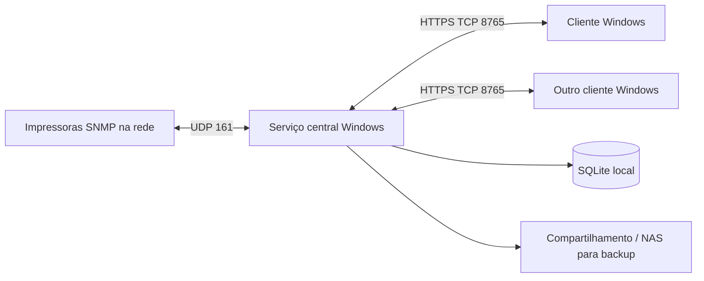

# Painel de Operação de Impressoras

Aplicativo desktop para Windows 10/11 que acompanha impressoras de rede por SNMP. Um serviço central coleta os dados e guarda o histórico; clientes instalados nos computadores da equipe apresentam um painel compartilhado, alertas e relatórios.

> Projeto em evolução, destinado a redes privadas e autogerenciadas. A disponibilidade de cada campo depende do firmware, da MIB implementada pela impressora e da configuração SNMP.

## Recursos

- Painel ilustrado com um cartão por impressora, status de conexão, estado reportado, contador acumulado, produção do dia e suprimentos.
- Cadastro manual de equipamentos por endereço IP, nome, versão SNMP e comunidade de leitura; fotos próprias opcionais.
- Coleta central a cada 30 segundos; a impressora fica offline depois de três falhas consecutivas.
- Alertas para indisponibilidade, toner em 5% ou menos, erros reportados pela impressora e falhas de backup.
- Histórico indefinido de mudanças e resumo horário; produção diária derivada da diferença do contador acumulado.
- Relatório diário e por intervalo, com exportação CSV compatível com Excel.
- Contas individuais, notificações nos clientes abertos e backup ZIP diário configurável.
- Compatibilidade com dados operacionais da Printer-MIB e Host-Resources-MIB quando o equipamento os disponibiliza.

## Componentes

O serviço central é o único componente que consulta as impressoras. Clientes não precisam de acesso SNMP à rede de impressão, somente HTTPS ao servidor.

## Começar

O repositório contém o código-fonte. Os executáveis prontos não são incluídos. Para instruções de instalação, compilação, rede e configuração, consulte:

- [Instalação](docs/INSTALACAO.md)
- [Configuração de impressoras e SNMP](docs/CONFIGURACAO.md)
- [Cobertura SNMP e referências de MIB](docs/SNMP.md)
- [Operação, histórico e backup](docs/OPERACAO.md)
- [Arquitetura e dados](docs/ARQUITETURA.md)
- [Solução de problemas](docs/SOLUCAO-DE-PROBLEMAS.md)
- [Segurança e privacidade](docs/SEGURANCA.md)
- [Relato de vulnerabilidade](SECURITY.md)
- [Suporte](SUPPORT.md)
- [Contribuição](CONTRIBUTING.md)

### Visão rápida

1. Em um computador Windows 10/11 que ficará ligado, instale Python 3.10+ e execute `instalar_servidor.bat` e `iniciar_servidor.bat`.
2. Libere TCP 8765 somente na rede privada e confirme que o servidor alcança as impressoras por UDP 161.
3. Em cada estação Windows, execute `instalar_cliente.bat` e `abrir_cliente.bat`.
4. Informe no cliente o endereço HTTPS e a impressão digital SHA256 que o servidor mostra.
5. Crie a primeira conta administrativa, depois cadastre usuários e impressoras.

Os detalhes e alternativas para gerar executáveis estão em [Instalação](docs/INSTALACAO.md). Não há endereços, comunidades SNMP ou equipamentos pré-cadastrados no código público.

## Produção diária: o que o sistema mede

As impressoras normalmente expõem um contador cumulativo. A produção diária é a diferença entre duas leituras sucessivas. O número representa a unidade informada pelo equipamento, como impressões ou folhas; não identifica documentos, trabalhos nem usuários e pode diferir do número de folhas físicas em impressão frente e verso.

A primeira leitura estabelece o ponto de partida. Se uma falha de coleta atravessar a meia-noite, o incremento é atribuído ao dia em que a conexão voltou e marcado como estimado. O sistema não recupera produção anterior à instalação.

## Requisitos resumidos

- Windows 10/11, 64 bits, para a aplicação desktop.
- Python 3.10+ com Tcl/Tk para executar pelo código-fonte ou compilar.
- SNMP v1 ou v2c configurado para leitura nas impressoras; o projeto não implementa SNMPv3 nesta versão.
- Rede privada entre o servidor e as impressoras (UDP 161) e entre clientes e o servidor (TCP 8765).

## Segurança

Use o serviço somente em rede privada. SNMP v1/v2c não criptografa comunidades; configure uma comunidade exclusiva de leitura quando possível. O tráfego entre clientes e serviço usa HTTPS com certificado próprio fixado por impressão digital. A comunidade e os dados operacionais ficam no banco central. Consulte [Segurança e privacidade](docs/SEGURANCA.md) antes de implantar.

## Licença

O projeto é distribuído sob a licença MIT; consulte [LICENSE](LICENSE).
