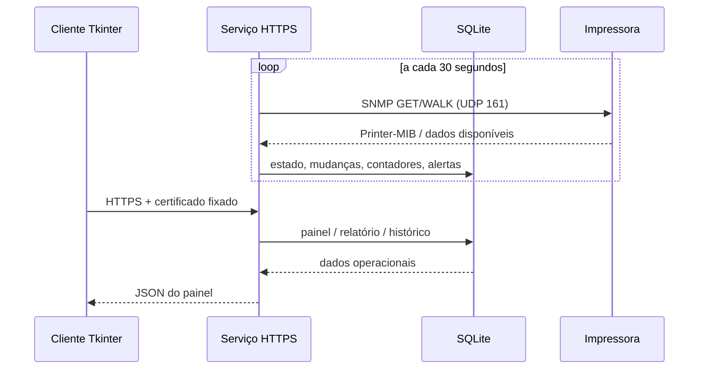

# Arquitetura

## Visão geral

- `server.py`: serviço HTTPS central, autenticação, banco SQLite, consulta SNMP, cálculo de produção, alertas, relatórios e backup.
- `client.py`: interface gráfica Tkinter, ilustrações locais, cadastro de equipamentos, consulta ao serviço, exportação CSV e notificações.
- Scripts `.bat`: criação de ambientes Python, inicialização e compilação de executáveis.
- SQLite: persistência local do serviço central; clientes não acessam o arquivo diretamente.

## Persistência

O serviço guarda arquivos em `%APPDATA%\ContadoresImpressoras` do usuário Windows que o inicia:

- `operacao.sqlite3`: dados relacionais; SQLite WAL pode criar arquivos `-wal` e `-shm` em execução.
- `servidor.pem` e `servidor-chave.pem`: certificado TLS local e chave privada.
- `conexao.txt`: URL da rede local e impressão digital SHA256 para configurar clientes.

Não coloque esses arquivos no controle de versão. O backup diário compacta um snapshot consistente do banco; certificados e chave privada não estão incluídos no ZIP.

## SNMP

O serviço usa PySNMP 7.1.x no adaptador `hlapi.v1arch.asyncio`. Cada dispositivo tem endereço, comunidade e versão. O fechamento do dispatcher deve usar a API `close()` disponibilizada pelo PySNMP 7.

O coletor faz um GET de identificadores, um WALK das tabelas de contador, suprimentos e bandejas e normaliza os valores conhecidos. Tabelas não suportadas são opcionais; falha no GET base marca a tentativa como malsucedida. Consultas são reunidas para os equipamentos cadastrados.

O status de conexão deriva do sucesso da consulta, enquanto o estado de impressão é derivado dos objetos expostos pelo aparelho. Esses estados não devem ser confundidos.

## Cálculo de produção

O contador de vida, normalmente `prtMarkerLifeCount`, é cumulativo. Para leituras `C_anterior` e `C_atual`, o incremento é `C_atual - C_anterior` quando não negativo. O serviço inclui tratamento para rollover de contador de 32 bits e mudanças de unidade/reset. Dados anteriores à primeira coleta não são conhecidos.

## Histórico e alertas

Uma leitura de sucesso atualiza `current_status`, resolve alertas de conexão recuperada e reconcilia erros/suprimentos ativos. O histórico registra a primeira leitura, mudanças relevantes e resumo horário. Alertas de toner são criados no limite configurado; indisponibilidade é sinalizada depois de três falhas.

## Endpoints da API

A API é interna ao cliente e não é um contrato público estável. Rotas agrupam status/setup/login/sessão, painel, equipamentos e fotos, alertas, relatórios, histórico, usuários, configurações de backup e teste de pasta. As rotas mutáveis exigem sessão autenticada. Não publique a API em redes não confiáveis nem exponha TCP 8765 à internet.
